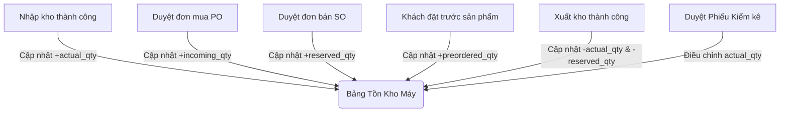

# 📋 ĐẶC TẢ YÊU CẦU NGHIỆP VỤ HỆ THỐNG QUẢN LÝ KHO (WMS) - NAMVIET WMS

Tài liệu này là văn bản tham chiếu nghiệp vụ chi tiết dành cho Nhà quản lý (Product Manager/Business Analyst) và Đội ngũ lập trình viên (Developer) để thiết lập cơ sở dữ liệu, xây dựng giao diện người dùng (Web UI) và hiện thực hóa các quy tắc nghiệp vụ trên hệ thống **NamViet WMS**. 

Nội dung dưới đây được cấu trúc hóa để có thể sao chép và điền trực tiếp vào 5 trang tính (sheets) trống trên Google Sheets của dự án bao gồm: **Tồn kho, Nhập kho, Xuất kho, Kiểm kê, Chuyển kho**.

---

## 1. SHEET: TỒN KHO (STOCK / INVENTORY)

### 1.1. Mục tiêu & Ánh xạ Giao diện Web (Goal & Web UI Mapping)
- **Mục tiêu của trang**: Quản lý chi tiết số lượng hàng hóa trong kho tại từng thời điểm. Hỗ trợ hiển thị trạng thái tồn kho thực tế lẫn tồn kho dự kiến để phục vụ cho hoạt động kinh doanh (Sales Order - SO) và mua hàng (Purchase Order - PO) không bị gián đoạn hoặc quá tải.
- **Ánh xạ giao diện Web (Web UI Routes & Components)**:
  - Trang danh sách tồn kho máy/vật tư: `/warehouse/stock` (Tách riêng khỏi trang quản lý kho `WarehouseListPage.jsx` thành `StockPage.jsx`).
  - Trang chi tiết vị trí tồn kho: `/warehouse/locations` (Tách riêng thành `LocationPage.jsx` hiển thị sơ đồ vị trí).
- **Các thành phần giao diện chính cần xây dựng**:
  - **Bộ lọc tìm kiếm (Filters)**: Lọc theo Kho (Warehouse), Nhóm hàng hóa (Product Category), SKU/Mã máy, Trạng thái (Còn hàng/Sắp hết/Hết hàng).
  - **Bảng dữ liệu (Data Table)**: Bảng phân trang hiển thị SKU, Tên vật tư, ĐVT, Tồn thực tế, Hàng đang về, Giữ kho, Đặt trước, Tồn dự kiến, Vị trí chi tiết.
  - **Nút hành động (Actions)**: Nút "Xuất báo cáo Excel", "Xem lịch sử thẻ kho (Card)", "Xem chi tiết vị trí".

### 1.2. Cấu trúc Dữ liệu & Thực thể (Database Fields / Entities)
Dưới đây là cấu trúc cột cần điền vào Sheet Tồn kho và thiết lập DB:

| STT | Tên cột (Tiếng Việt) | Database Key (English) | Kiểu dữ liệu | Bắt buộc | Mô tả & Quy tắc định dạng |
| :--- | :--- | :--- | :--- | :--- | :--- |
| 1 | Mã kho | `warehouse_id` | Foreign Key | Có | Liên kết với danh mục Kho hàng |
| 2 | Tên kho | `warehouse_name` | Text | Có | Hiển thị tên kho vật lý (Ví dụ: Kho chính, Kho phụ) |
| 3 | SKU / Mã máy | `product_code` | Text | Có | Mã định danh duy nhất của sản phẩm/vật tư |
| 4 | Tên hàng / Vật tư | `product_name` | Text | Có | Tên chi tiết của sản phẩm/thiết bị |
| 5 | Đơn vị tính | `unit` | Text | Có | ĐVT chuẩn (Cái, Bộ, Thùng, kg,...) |
| 6 | Thực tế - Tổng tồn | `actual_qty` | Decimal (18, 2) | Có | Số lượng thực tế đang nằm trong kho vật lý `[1]` |
| 7 | Dự kiến - Có hàng | `incoming_qty` | Decimal (18, 2) | Có | Số lượng hàng đang về từ các PO đã duyệt nhưng chưa nhập kho `[2]` |
| 8 | Dự kiến - Giữ kho | `reserved_qty` | Decimal (18, 2) | Có | Số lượng hàng đã được giữ cho các đơn SO đã duyệt nhưng chưa xuất kho `[3]` |
| 9 | Dự kiến - Đặt trước | `preordered_qty` | Decimal (18, 2) | Có | Số lượng hàng khách đã đặt trước (chưa tạo SO chính thức) `[4]` |
| 10 | Dự kiến - Tồn khả dụng| `available_qty` | Decimal (18, 2) | Có | Tồn kho dự tính có thể bán/sử dụng. Công thức: `[1] + [2] - [3] - [4]` |
| 11 | Vị trí kho chi tiết | `location_detail` | JSON / Text | Có | Danh sách vị trí kệ/ô chi tiết và số lượng tương ứng (Ví dụ: `{"Kệ A1-02": 10, "Kệ B2-01": 5}`) |
| 12 | Trạng thái kiểm kê | `is_frozen` | Boolean | Có | `True` nếu sản phẩm đang trong quá trình kiểm kê (Khóa giao dịch), mặc định là `False` |

### 1.3. Luồng Nghiệp vụ Hệ thống (System Workflow)

1. **Mua hàng & Nhập kho**: Khi đơn mua hàng PO được duyệt -> hệ thống cộng tăng `incoming_qty`. Khi hàng về tới kho và thủ kho thực hiện duyệt Phiếu Nhập kho -> hệ thống trừ `incoming_qty` tương ứng và cộng tăng `actual_qty`.
2. **Bán hàng & Xuất kho**: Khi đơn bán hàng SO được duyệt -> hệ thống cộng tăng `reserved_qty`. Khi thủ kho đóng gói và duyệt Phiếu Xuất kho -> hệ thống trừ `reserved_qty` và trừ `actual_qty` tương ứng.
3. **Đặt trước**: Khi có yêu cầu pre-order từ khách hàng -> hệ thống ghi nhận vào `preordered_qty`, làm giảm `available_qty` tương ứng để tránh bán trùng cho khách hàng khác.
4. **Kiểm kê**: Khi phát sinh chênh lệch kiểm kê và phiếu kiểm kê được phê duyệt -> thủ kho cập nhật số liệu `actual_qty` bằng số thực tế đã kiểm đếm, đồng thời hệ thống ghi nhận lịch sử điều chỉnh.

### 1.4. Các Quy tắc Nghiệp vụ Cốt lõi (Core Business Rules - BR)
- **BR-ST-01 (Công thức tính tồn khả dụng)**: Trường `available_qty` (Tồn dự kiến) luôn luôn được tính tự động bởi hệ thống theo công thức: 
  $$\text{Tồn khả dụng (available\_qty)} = \text{Thực tế (actual\_qty)} + \text{Đang về (incoming\_qty)} - \text{Giữ kho (reserved\_qty)} - \text{Đặt trước (preordered\_qty)}$$
- **BR-ST-02 (Khóa giao dịch khi kiểm kê)**: Khi một SKU tại một Vị trí kho chi tiết được đưa vào phiếu kiểm kê có trạng thái "Đang kiểm đếm" (`counting`), hệ thống phải tự động set `is_frozen = True`. Tại thời điểm này, mọi giao dịch Nhập, Xuất, Chuyển kho liên quan đến SKU tại vị trí đó đều bị chặn cho đến khi phiếu kiểm kê chuyển sang trạng thái "Đã điều chỉnh" hoặc "Hủy".
- **BR-ST-03 (Tồn kho khả dụng âm)**: Hệ thống không cho phép duyệt các yêu cầu xuất kho tức thời hoặc đơn SO thông thường nếu `available_qty` sau khi trừ đi số lượng yêu cầu nhỏ hơn 0, ngoại trừ trường hợp có cấu hình đặc biệt cho phép bán âm đối với hàng sắp về (khi `incoming_qty` lớn hơn lượng âm).

---

## 2. SHEET: NHẬP KHO (IMPORT / RECEIVING)

### 2.1. Mục tiêu & Ánh xạ Giao diện Web (Goal & Web UI Mapping)
- **Mục tiêu của trang**: Quản lý toàn bộ vòng đời của các chứng từ nhập kho từ khi lập yêu cầu, phê duyệt thông tin tài chính/thuế, kiểm đếm thực tế của thủ kho đến khi cập nhật hàng vào thẻ kho.
- **Ánh xạ giao diện Web (Web UI Routes & Components)**:
  - Trang danh sách phiếu nhập chung: `/warehouse/import` (`ImportListPage.jsx` - hiển thị toàn bộ các phiếu).
  - Trang nhập hàng trong nước: `/warehouse/import/domestic` (`ImportDomesticPage.jsx` - nhập nội địa từ nhà cung cấp).
  - Trang nhập hàng ngoài nước: `/warehouse/import/foreign` (`ImportForeignPage.jsx` - nhập khẩu, cần điền thêm tờ khai hải quan, thuế nhập khẩu).
  - Trang nhập thành phẩm sản xuất: `/warehouse/import/finished` (`ImportFinishedPage.jsx` - nhập từ xưởng sản xuất nội bộ).
- **Các thành phần giao diện chính cần xây dựng**:
  - **Form tạo phiếu**: Chia làm 2 phần (Thông tin chung của phiếu & Bảng danh sách hàng chi tiết - Line items).
  - **Bộ lọc danh sách**: Tìm theo Loại nhập (Trong nước/Ngoài nước/Thành phẩm), Kho nhập, Nhà cung cấp, Trạng thái phiếu, Khoảng ngày lập.
  - **Nút hành động**: "Tạo mới phiếu nhập", "Nhập Excel sản phẩm", "In phiếu nhập kho (PDF)", "Phê duyệt phiếu".

### 2.2. Cấu trúc Dữ liệu & Thực thể (Database Fields / Entities)
Dưới đây là cấu trúc bảng chi tiết cho Nhập kho (gồm thông tin Phiếu chính và Line Items chi tiết):

#### A. Thông tin phiếu (Import Ticket Headers)
| STT | Tên cột (Tiếng Việt) | Database Key (English) | Kiểu dữ liệu | Bắt buộc | Mô tả & Quy tắc định dạng |
| :--- | :--- | :--- | :--- | :--- | :--- |
| 1 | Mã chứng từ | `import_code` | Text | Có | Tự động sinh theo format: `NK-YYYYMMDD-XXXX` (Ví dụ: `NK-20260601-0001`) |
| 2 | Ngày lập | `created_date` | Date/Time | Có | Thời gian khởi tạo phiếu nhập |
| 3 | Loại nhập | `import_type` | Enum | Có | Giá trị bắt buộc: `domestic` (Trong nước) / `foreign` (Ngoài nước) / `finished` (Thành phẩm) |
| 4 | Kho nhập | `warehouse_id` | Foreign Key | Có | ID của kho đích tiếp nhận hàng |
| 5 | Nhà cung cấp / Đối tác | `supplier_id` | Foreign Key | Không | ID nhà cung cấp (bắt buộc nếu loại nhập là domestic hoặc foreign) |
| 6 | Người lập | `created_by` | Foreign Key | Có | ID của user nhân viên mua hàng / thủ kho tạo phiếu |
| 7 | Người duyệt | `approved_by` | Foreign Key | Không | ID của quản lý phê duyệt phiếu |
| 8 | Số PO liên kết | `po_code` | Text | Không | Liên kết với mã Đơn mua hàng để đối chiếu công nợ và số lượng |
| 9 | Lý do nhập kho | `description` | Text | Không | Lý do chi tiết hoặc ghi chú chung |
| 10 | Trạng thái | `status` | Enum | Có | `draft` (Nháp) / `pending_approval` (Chờ duyệt) / `approved` (Đã duyệt) / `cancelled` (Hủy) |

#### B. Danh sách hàng hóa chi tiết (Import Ticket Line Items)
| STT | Tên cột (Tiếng Việt) | Database Key (English) | Kiểu dữ liệu | Bắt buộc | Mô tả & Quy tắc định dạng |
| :--- | :--- | :--- | :--- | :--- | :--- |
| 1 | SKU / Mã hàng | `product_code` | Text | Có | Mã của sản phẩm cần nhập |
| 2 | Hình ảnh sản phẩm | `product_image` | Text/URL | Không | Đường dẫn ảnh của sản phẩm để thủ kho đối chiếu trực quan |
| 3 | Tên hàng / Vật tư | `product_name` | Text | Có | Tên sản phẩm hiển thị tự động theo SKU |
| 4 | Vị trí kho chi tiết | `location_id` | Foreign Key | Có | Vị trí cụ thể (Kệ/Hàng/Ô) xếp hàng vào (Ví dụ: LOC-A1-02) |
| 5 | Đơn vị tính | `unit` | Text | Có | ĐVT tương ứng của SKU |
| 6 | SL yêu cầu | `request_qty` | Decimal | Có | Số lượng theo chứng từ mua hàng/kế hoạch |
| 7 | SL thực tế nhập | `actual_qty` | Decimal | Có | Số lượng thực nhận sau khi thủ kho kiểm đếm thực tế |
| 8 | Đơn giá | `price` | Decimal | Có | Đơn giá nhập của sản phẩm (chưa VAT) |
| 9 | Khuyến mãi (%) | `discount_percent` | Decimal | Có | Phần trăm chiết khấu trên từng dòng sản phẩm. Mặc định là `0` |
| 10 | Thuế (%) | `tax_percent` | Decimal | Có | Phần trăm thuế VAT. Mặc định là `10` hoặc `8` tùy mặt hàng |
| 11 | Thành tiền | `total_amount` | Decimal | Có | Giá trị sau chiết khấu và thuế. Công thức: `actual_qty * price * (1 - discount_percent/100) * (1 + tax_percent/100)` |
| 12 | Ghi chú dòng | `item_note` | Text | Không | Ghi chú cụ thể cho SKU này (ví dụ: móp vỏ hộp, đổi màu...) |

### 2.3. Luồng Nghiệp vụ Hệ thống (System Workflow)
```
[Nhân viên/Kế toán mua hàng]     [Quản lý/Kế toán trưởng]              [Thủ kho vật lý]
    Lập Phiếu Nhập (Draft)               Phê duyệt giá & VAT            Kiểm đếm thực tế
      (Liên kết PO nếu có)             (Chuyển sang Chờ nhập)         (Điền SL thực tế & Vị trí)
               │                                  │                                │
               ▼                                  ▼                                ▼
       [Status: Draft] ─────────► [Status: Pending Approval] ─────────► [Status: Approved]
                                                                                   │
                                                                                   ▼
                                                                        [Cập nhật Tồn kho]
                                                                      - Cộng actual_qty
                                                                      - Trừ incoming_qty
```
1. **Bước 1: Khởi tạo phiếu**: Bộ phận Mua hàng hoặc Kế toán tạo phiếu nhập dạng `draft`. Nếu nhập hàng từ nhà cung cấp, bắt buộc chọn liên kết số PO. Nhập danh sách SKU và `request_qty`.
2. **Bước 2: Xác thực tài chính**: Kế toán kiểm tra Đơn giá, Khuyến mãi, Thuế suất của từng mặt hàng và nhấn "Gửi duyệt". Trạng thái phiếu chuyển sang `pending_approval`.
3. **Bước 3: Thực nhập & Gán vị trí**: Khi hàng về tới kho, Thủ kho tiến hành kiểm đếm số lượng thực tế nhận được và điền vào cột `actual_qty`. Đồng thời, Thủ kho chọn vị trí kệ (`location_id`) cho từng mặt hàng trên giao diện và nhấn "Xác nhận nhập kho".
4. **Bước 4: Phê duyệt & Cập nhật số liệu**: Người có thẩm quyền nhấn "Duyệt phiếu". Trạng thái chuyển sang `approved`. Hệ thống tự động ghi tăng tồn thực tế (`actual_qty`) tại vị trí đã chọn trong kho, đồng thời giảm lượng hàng đang về (`incoming_qty`) tương ứng trên hệ thống.

### 2.4. Các Quy tắc Nghiệp vụ Cốt lõi (Core Business Rules - BR)
- **BR-IP-01 (Kiểm soát chênh lệch SL)**: Số lượng thực tế nhập `actual_qty` không được phép vượt quá 105% số lượng yêu cầu `request_qty` trên PO liên kết. Nếu vượt quá, hệ thống yêu cầu người dùng phải cập nhật lại PO hoặc tạo phiếu nhập phát sinh ngoài PO được duyệt bởi Giám đốc kho.
- **BR-IP-02 (Ràng buộc vị trí bắt buộc)**: Không cho phép duyệt Phiếu Nhập kho (`status = approved`) nếu bất kỳ dòng sản phẩm (Line Item) nào có số lượng thực nhận `actual_qty > 0` mà chưa được gán vị trí kho chi tiết (`location_id`).
- **BR-IP-03 (Khóa chỉnh sửa)**: Sau khi phiếu nhập chuyển sang trạng thái `approved`, hệ thống sẽ đóng băng toàn bộ thông tin phiếu. Nghiêm cấm mọi hành vi chỉnh sửa hoặc xóa phiếu. Nếu có sai sót, phải thực hiện quy trình xuất trả hàng nhà cung cấp hoặc lập phiếu kiểm kê điều chỉnh.

---

## 3. SHEET: XUẤT KHO (EXPORT / SHIPPING)

### 3.1. Mục tiêu & Ánh xạ Giao diện Web (Goal & Web UI Mapping)
- **Mục tiêu của trang**: Quản lý xuất hàng hóa ra khỏi kho để bàn giao cho khách hàng (theo đơn SO), cung cấp nguyên vật liệu cho xưởng sản xuất, hoặc xuất hủy, xuất nội bộ. Đảm bảo hàng xuất đi đúng số lượng, đúng chủng loại, đúng vị trí kệ và ghi nhận số Serial chính xác.
- **Ánh xạ giao diện Web (Web UI Routes & Components)**:
  - Trang danh sách phiếu xuất chung: `/warehouse/export` (`ExportListPage.jsx` - quản lý chung).
  - Trang xuất kho giao hàng (Bán hàng): `/warehouse/export/delivery` (`ExportDeliveryPage.jsx` - kết nối đơn hàng SO).
  - Trang xuất kho sản xuất: `/warehouse/export/production` (`ExportProductionPage.jsx` - xuất nguyên vật liệu cho sản xuất).
  - Trang xuất kho khác: `/warehouse/export/other` (`ExportOtherPage.jsx` - xuất hủy, xuất tặng, tiêu dùng nội bộ).
- **Các thành phần giao diện chính cần xây dựng**:
  - **Form tạo phiếu**: Hỗ trợ quét mã vạch (Barcode/QR) để điền nhanh SKU và số Serial của máy.
  - **Trình chọn Vị trí thông minh**: Gợi ý các vị trí kho đang có sẵn SKU này theo nguyên tắc FIFO (Vào trước - Xuất trước) hoặc FEFO.
  - **Nút hành động**: "Lập phiếu xuất", "In phiếu đóng gói (Packing List)", "In phiếu xuất kho kiêm vận chuyển nội bộ (PDF)".

### 3.2. Cấu trúc Dữ liệu & Thực thể (Database Fields / Entities)
Dưới đây là cấu trúc bảng chi tiết cho Xuất kho:

#### A. Thông tin phiếu (Export Ticket Headers)
| STT | Tên cột (Tiếng Việt) | Database Key (English) | Kiểu dữ liệu | Bắt buộc | Mô tả & Quy tắc định dạng |
| :--- | :--- | :--- | :--- | :--- | :--- |
| 1 | Mã chứng từ | `export_code` | Text | Có | Sinh tự động theo định dạng: `XK-YYYYMMDD-XXXX` (Ví dụ: `XK-20260601-0001`) |
| 2 | Đơn hàng liên kết (SO/PO) | `so_po_code` | Text | Không | Ghi nhận mã đơn bán hàng SO hoặc phiếu chuyển kho nội bộ để đối chiếu |
| 3 | Loại xuất | `export_type` | Enum | Có | Giá trị bắt buộc: `delivery` (Giao hàng) / `production` (Sản xuất) / `other` (Xuất khác) |
| 4 | Khách hàng / Đối tác | `customer_name` | Text | Không | Tên khách hàng nhận hàng (bắt buộc nếu loại là delivery) |
| 5 | Địa chỉ giao hàng | `delivery_address` | Text | Không | Địa chỉ cụ thể để giao nhận hàng hóa |
| 6 | Ngày cần giao | `delivery_date` | Date | Có | Hạn chót cần giao hàng cho đối tác |
| 7 | Kho xuất | `warehouse_id` | Foreign Key | Có | ID kho xuất hàng đi |
| 8 | Người lập | `created_by` | Foreign Key | Có | ID user nhân viên tạo yêu cầu xuất |
| 9 | Người duyệt | `approved_by` | Foreign Key | Không | ID user quản lý duyệt xuất kho |
| 10 | Trạng thái | `status` | Enum | Có | `draft` (Nháp) / `pending_approval` (Chờ duyệt) / `approved` (Đã xuất) / `cancelled` (Hủy) |
| 11 | Ghi chú | `description` | Text | Không | Ghi chú chung của phiếu xuất |

#### B. Danh sách hàng hóa chi tiết (Export Ticket Line Items)
| STT | Tên cột (Tiếng Việt) | Database Key (English) | Kiểu dữ liệu | Bắt buộc | Mô tả & Quy tắc định dạng |
| :--- | :--- | :--- | :--- | :--- | :--- |
| 1 | SKU / Mã hàng | `product_code` | Text | Có | Mã của sản phẩm cần xuất |
| 2 | Hình ảnh | `product_image` | Text/URL | Không | Đường dẫn ảnh của vật tư |
| 3 | Tên sản phẩm | `product_name` | Text | Có | Tên hiển thị tương ứng |
| 4 | Số Serial | `serial_number` | Text | Không | Mã định danh duy nhất của từng máy (Bắt buộc đối với mặt hàng quản lý theo serial) |
| 5 | Đơn vị tính | `unit` | Text | Có | ĐVT của sản phẩm |
| 6 | Số lượng xuất | `export_qty` | Decimal | Có | Số lượng hàng yêu cầu xuất |
| 7 | Đơn giá xuất | `price` | Decimal | Không | Giá xuất bán hoặc giá vốn tùy loại xuất |
| 8 | Tổng tiền | `total_amount` | Decimal | Không | Tổng giá trị dòng hàng. Công thức: `export_qty * price` |
| 9 | Vị trí xuất chi tiết | `location_id` | Foreign Key | Có | Vị trí cụ thể (kệ, ô) lấy hàng ra khỏi kho |
| 10 | Ghi chú dòng | `item_note` | Text | Không | Ghi chú cho dòng vật tư này |

### 3.3. Luồng Nghiệp vụ Hệ thống (System Workflow)
```
[Bộ phận Kinh doanh]           [Hệ thống WMS]                     [Thủ kho vật lý]
Tạo yêu cầu xuất (Draft) ──► Kiểm tra Tồn khả dụng ──────────► Lấy hàng theo vị trí kệ
  từ đơn hàng SO             Nếu đủ -> Chuyển Chờ duyệt         Quét Barcode / Số Serial
                             Giữ kho (+reserved_qty)                     │
                                                                         ▼
                                                              Phê duyệt hoàn tất xuất
                                                              - Trừ thực tế (-actual_qty)
                                                              - Trừ giữ kho (-reserved_qty)
```
1. **Bước 1: Tiếp nhận yêu cầu**: Nhân viên kinh doanh tạo yêu cầu xuất hàng (Draft) dựa trên đơn bán hàng SO đã chốt với khách hàng. Hệ thống liên kết địa chỉ giao hàng và danh sách hàng hóa tự động.
2. **Bước 2: Gác tồn (Hold hàng)**: Hệ thống tự động kiểm tra tồn khả dụng `available_qty` của các SKU yêu cầu. Nếu đủ hàng, phiếu chuyển sang trạng thái `pending_approval` và cộng tăng `reserved_qty` tương ứng để giữ hàng, không cho đơn khác lấy mất.
3. **Bước 3: Lấy hàng (Picking)**: Thủ kho dựa trên danh sách vị trí gợi ý trên app để tới đúng kệ lấy hàng. Với hàng hóa đặc thù có quản lý Serial, thủ kho thực hiện quét barcode hoặc nhập mã `serial_number` của từng máy vào hệ thống.
4. **Bước 4: Xác nhận xuất kho**: Khi hàng đã xếp lên xe/bàn giao vận chuyển, thủ kho nhấn "Xác nhận xuất kho" (`status = approved`). Hệ thống sẽ tự động khấu trừ `actual_qty` và `reserved_qty` trong cơ sở dữ liệu tồn kho.

### 3.4. Các Quy tắc Nghiệp vụ Cốt lõi (Core Business Rules - BR)
- **BR-EP-01 (Chặn xuất quá tồn khả dụng)**: Hệ thống tuyệt đối chặn không cho phép gửi duyệt phiếu xuất nếu `export_qty` của một dòng hàng lớn hơn `available_qty` tại thời điểm tạo phiếu.
- **BR-EP-02 (Ràng buộc Serial Number)**: Đối với các danh mục hàng hóa được cấu hình quản lý theo số Serial (Ví dụ: Thiết bị máy móc chính của Nam Việt), số lượng xuất `export_qty` bắt buộc phải bằng đúng số lượng các mã `serial_number` được khai báo chi tiết. Mỗi số Serial xuất đi phải tồn tại trong kho và ở trạng thái "Trong kho".
- **BR-EP-03 (Nguyên tắc chọn vị trí xuất)**: Hệ thống ưu tiên đề xuất vị trí lấy hàng theo thứ tự: vị trí có hạn sử dụng ngắn nhất trước (FEFO), hoặc vị trí có ngày nhập kho xa nhất trước (FIFO). Thủ kho có thể đổi vị trí thủ công nếu có sự cố vật lý tại vị trí đề xuất nhưng phải chọn lý do đổi vị trí.

---

## 4. SHEET: KIỂM KÊ (STOCKTAKE)

### 4.1. Mục tiêu & Ánh xạ Giao diện Web (Goal & Web UI Mapping)
- **Mục tiêu của trang**: Định kỳ đối chiếu số liệu tồn kho thực tế ngoài kho vật lý với số liệu đang ghi nhận trên hệ thống phần mềm WMS. Phát hiện kịp thời các chênh lệch thừa/thiếu, tìm nguyên nhân và thực hiện điều chỉnh số liệu hệ thống khớp với thực tế sau khi có phê duyệt từ Ban giám đốc.
- **Ánh xạ giao diện Web (Web UI Routes & Components)**:
  - Danh sách phiếu kiểm kê: `/stocktake/list` (`StocktakeListPage.jsx`).
  - Lịch sử phiếu điều chỉnh tồn: `/stocktake/adjustment` (`AdjustmentListPage.jsx`).
  - Thiết lập đợt kiểm kê: `/stocktake/settings` (`StocktakeSettingsPage.jsx` - quản lý chu kỳ kiểm kê).
- **Các thành phần giao diện chính cần xây dựng**:
  - **Màn hình kiểm đếm (Counting Screen)**: Giao diện tối ưu cho thiết bị di động/máy tính bảng để thủ kho vừa đi đếm hàng vừa nhập trực tiếp số lượng thực tế.
  - **Bảng so sánh đối chiếu chênh lệch**: Tự động highlight màu đỏ cho các dòng có chênh lệch âm (thiếu hụt) và màu xanh cho chênh lệch dương (dư thừa).

### 4.2. Cấu trúc Dữ liệu & Thực thể (Database Fields / Entities)
Dưới đây là cấu trúc bảng chi tiết cho Kiểm kê:

#### A. Thông tin phiếu (Stocktake Ticket Headers)
| STT | Tên cột (Tiếng Việt) | Database Key (English) | Kiểu dữ liệu | Bắt buộc | Mô tả & Quy tắc định dạng |
| :--- | :--- | :--- | :--- | :--- | :--- |
| 1 | Mã phiếu kiểm kê | `stocktake_code` | Text | Có | Định dạng: `KK-YYYYMMDD-XXXX` (Ví dụ: `KK-20260601-0001`) |
| 2 | Ngày kiểm kê | `stocktake_date` | Date/Time | Có | Ngày tiến hành kiểm kê thực tế |
| 3 | Kho kiểm kê | `warehouse_id` | Foreign Key | Có | ID của kho thực hiện kiểm kê |
| 4 | Người kiểm kê | `inspector_id` | Foreign Key | Có | ID người chịu trách nhiệm chính kiểm đếm |
| 5 | Người phê duyệt | `approved_by` | Foreign Key | Không | ID của Giám đốc/Kế toán trưởng phê duyệt kết quả điều chỉnh |
| 6 | Trạng thái | `status` | Enum | Có | `draft` (Nháp) / `counting` (Đang đếm - Khóa kho) / `completed` (Đã đếm xong) / `adjusted` (Đã điều chỉnh tồn) / `cancelled` (Hủy) |
| 7 | Ghi chú / Lý do | `description` | Text | Không | Lý do kiểm kê (Định kỳ tháng/quý, kiểm kê đột xuất...) |

#### B. Danh sách kiểm đếm chi tiết (Stocktake Line Items)
| STT | Tên cột (Tiếng Việt) | Database Key (English) | Kiểu dữ liệu | Bắt buộc | Mô tả & Quy tắc định dạng |
| :--- | :--- | :--- | :--- | :--- | :--- |
| 1 | SKU / Mã hàng | `product_code` | Text | Có | SKU sản phẩm kiểm kê |
| 2 | Tên vật tư / hàng hóa | `product_name` | Text | Có | Tên sản phẩm tự động hiển thị |
| 3 | Vị trí kiểm kê | `location_id` | Foreign Key | Có | Vị trí chi tiết đang kiểm đếm (Ví dụ: LOC-A1-02) |
| 4 | Đơn vị tính | `unit` | Text | Có | ĐVT tương ứng |
| 5 | SL trên sổ sách | `system_qty` | Decimal | Có | Số lượng tồn kho ghi nhận trên hệ thống tại thời điểm khóa kho để kiểm đếm |
| 6 | SL thực tế kiểm kê | `actual_qty` | Decimal | Có | Số lượng thực tế thủ kho kiểm đếm và nhập vào phần mềm |
| 7 | Chênh lệch | `difference_qty` | Decimal | Có | Tự động tính. Công thức: `actual_qty - system_qty` |
| 8 | Phương án xử lý | `handling_plan` | Text | Không | Đề xuất xử lý chênh lệch (Ví dụ: Phạt thủ kho đền, ghi nhận chi phí hao hụt, tìm thấy hàng để sai vị trí...) |

### 4.3. Luồng Nghiệp vụ Hệ thống (System Workflow)
```
[Tạo phiếu Draft] ──► [Bắt đầu kiểm kê (Status: Counting)] ──► [Nhập kết quả kiểm đếm]
                               │                                        │
                               ▼                                        ▼
                       - Snapshot system_qty                   - Nhập actual_qty
                       - set is_frozen = True                  - Tính difference_qty
                       - Chặn Nhập/Xuất/Chuyển                          │
                                                                        ▼
                                                             [Phê duyệt & Điều chỉnh]
                                                             - Cập nhật actual_qty tồn kho
                                                             - set is_frozen = False
                                                             - Tạo Phiếu Điều Chỉnh Tự Động
```
1. **Bước 1: Lập kế hoạch**: Quản lý tạo phiếu kiểm kê dạng `draft`, chọn Kho cần kiểm kê và danh sách các nhóm hàng hoặc toàn bộ kho.
2. **Bước 2: Khóa kho & Snapshot số liệu**: Khi bấm nút "Bắt đầu kiểm kê", trạng thái phiếu chuyển sang `counting`. Hệ thống lập tức thực hiện 2 hành động tự động:
   - Chụp lại số lượng tồn hiện tại của hệ thống ghi vào cột `system_qty`.
   - Chuyển `is_frozen = True` cho các sản phẩm/vị trí tương ứng để chặn mọi hoạt động xuất/nhập/chuyển phát sinh trong lúc đếm.
3. **Bước 3: Kiểm đếm thực tế**: Tổ kiểm kê đi đếm hàng thực tế tại kho và nhập số lượng vào cột `actual_qty` trên phần mềm. Hệ thống tự động tính toán `difference_qty`. Sau khi đếm xong, bấm "Hoàn tất kiểm đếm", trạng thái chuyển sang `completed`.
4. **Bước 4: Duyệt kết quả & Điều chỉnh tồn**: Quản lý kho và kế toán đối chiếu các dòng chênh lệch. Đối với dòng chênh lệch, bắt buộc nhập `handling_plan`. Sau đó, người có thẩm quyền nhấn "Duyệt điều chỉnh". Trạng thái chuyển sang `adjusted`. Hệ thống tự động:
   - Cập nhật số lượng tồn kho `actual_qty` của hệ thống bằng đúng số lượng `actual_qty` kiểm kê thực tế.
   - Giải phóng trạng thái khóa kho (`is_frozen = False`).
   - Tự động sinh ra một phiếu điều chỉnh tồn kho (`Stock Adjustment`) tương ứng để lưu vết sổ sách kế toán.

### 4.4. Các Quy tắc Nghiệp vụ Cốt lõi (Core Business Rules - BR)
- **BR-STK-01 (Đóng băng dữ liệu tồn)**: Trong suốt thời gian phiếu kiểm kê ở trạng thái `counting` (Đang kiểm đếm), bất kỳ hành động nào cố gắng Nhập kho, Xuất kho hoặc Chuyển kho liên quan đến SKU và vị trí nằm trong phiếu kiểm kê đó đều phải bị hệ thống từ chối và báo lỗi: *"Sản phẩm tại vị trí này đang bị khóa để kiểm kê"*.
- **BR-STK-02 (Thời điểm chốt số liệu sổ sách)**: Giá trị của cột `system_qty` (SL sổ sách) phải được lấy tự động từ bảng Tồn kho tại đúng thời điểm bấm nút chuyển trạng thái phiếu từ `draft` sang `counting`. Không được dùng số lượng tại thời điểm tạo phiếu nháp.
- **BR-STK-03 (Bắt buộc giải trình chênh lệch)**: Hệ thống không cho phép duyệt phiếu kiểm kê nếu có dòng chênh lệch (`difference_qty != 0`) mà cột `handling_plan` (Phương án xử lý) của dòng đó bị bỏ trống.

---

## 5. SHEET: CHUYỂN KHO (TRANSFER / CONVERSION)

### 5.1. Mục tiêu & Ánh xạ Giao diện Web (Goal & Web UI Mapping)
- **Mục tiêu của trang**: Quản lý việc luân chuyển hàng hóa giữa các kho vật lý khác nhau trong hệ thống công ty (Ví dụ: Chuyển từ Kho chính sang Kho phụ) hoặc thực hiện chuyển đổi trạng thái/phân loại hàng hóa (Conversion). Đảm bảo kiểm soát chặt chẽ hàng hóa trong quá trình vận chuyển (In Transit) để không bị thất thoát.
- **Ánh xạ giao diện Web (Web UI Routes & Components)**:
  - Trang danh sách phiếu chuyển kho: `/warehouse/transfer` (`TransferListPage.jsx`).
  - Trang tạo mới / Chi tiết chuyển kho: `/warehouse/transfer/create` hoặc `/warehouse/transfer/detail`.
  - Trang danh sách chuyển đổi loại hàng: `/warehouse/conversion` (`ConversionListPage.jsx`).
- **Các thành phần giao diện chính cần xây dựng**:
  - **Form tạo phiếu**: Cho phép chọn Kho nguồn, Kho đích, Vị trí xuất phát và Vị trí đích đến.
  - **Giao diện xác nhận 2 đầu (Double-confirmation UI)**: Đầu xuất kho nguồn duyệt xuất -> Đầu nhận kho đích duyệt nhận.
  - **Báo cáo hàng đang đi đường**: Hiển thị danh sách các phiếu đang ở trạng thái `in_transit` để theo dõi tiến độ vận chuyển.

### 5.2. Cấu trúc Dữ liệu & Thực thể (Database Fields / Entities)
Dưới đây là cấu trúc bảng chi tiết cho Chuyển kho:

#### A. Thông tin phiếu (Transfer Ticket Headers)
| STT | Tên cột (Tiếng Việt) | Database Key (English) | Kiểu dữ liệu | Bắt buộc | Mô tả & Quy tắc định dạng |
| :--- | :--- | :--- | :--- | :--- | :--- |
| 1 | Mã chứng từ | `transfer_code` | Text | Có | Định dạng tự sinh: `CK-YYYYMMDD-XXXX` (Ví dụ: `CK-20260601-0001`) |
| 2 | Ngày lập | `created_date` | Date/Time | Có | Thời điểm khởi tạo yêu cầu chuyển |
| 3 | Kho nguồn | `source_warehouse_id` | Foreign Key | Có | ID của kho xuất phát hàng |
| 4 | Kho đích | `target_warehouse_id` | Foreign Key | Có | ID của kho tiếp nhận hàng |
| 5 | Người lập | `created_by` | Foreign Key | Có | ID của user nhân viên tạo yêu cầu chuyển |
| 6 | Trạng thái phê duyệt | `status` | Enum | Có | Bắt buộc các trạng thái: `draft` (Nháp) / `pending_out` (Chờ xuất) / `in_transit` (Đang đi đường) / `completed` (Hoàn thành) / `cancelled` (Hủy) |
| 7 | Người duyệt xuất (Nguồn) | `out_approved_by` | Foreign Key | Không | ID thủ kho nguồn xác nhận đã giao hàng đi |
| 8 | Người duyệt nhận (Đích) | `in_approved_by` | Foreign Key | Không | ID thủ kho đích xác nhận đã nhận đủ hàng |
| 9 | Lý do chuyển kho | `description` | Text | Không | Ghi rõ mục đích chuyển kho (Ví dụ: Chuyển hàng chi nhánh, cân bằng tồn kho, phục vụ dự án...) |

#### B. Danh sách hàng hóa chi tiết (Transfer Line Items)
| STT | Tên cột (Tiếng Việt) | Database Key (English) | Kiểu dữ liệu | Bắt buộc | Mô tả & Quy tắc định dạng |
| :--- | :--- | :--- | :--- | :--- | :--- |
| 1 | SKU / Mã hàng | `product_code` | Text | Có | SKU của sản phẩm cần chuyển |
| 2 | Tên hàng / Vật tư | `product_name` | Text | Có | Tên sản phẩm tự động hiển thị |
| 3 | Đơn vị tính | `unit` | Text | Có | ĐVT của SKU |
| 4 | Vị trí kho nguồn | `source_location_id` | Foreign Key | Có | Kệ/hàng/ô xuất phát tại kho nguồn |
| 5 | Tồn thực tế tại nguồn | `source_actual_qty` | Decimal | Có | Tồn thực tế tại vị trí nguồn ở thời điểm xuất phát để đối chiếu |
| 6 | Vị trí kho đích | `target_location_id` | Foreign Key | Có | Kệ/hàng/ô dự kiến xếp vào tại kho đích khi hàng đến |
| 7 | Số lượng chuyển | `transfer_qty` | Decimal | Có | Số lượng yêu cầu luân chuyển |
| 8 | Ghi chú dòng | `item_note` | Text | Không | Ghi chú chi tiết cho dòng hàng hóa này |

### 5.3. Luồng Nghiệp vụ Hệ thống (System Workflow)
```
[Tạo yêu cầu chuyển (Draft)] ──► [Gửi yêu cầu (Status: Pending Out)]
                                            │
                                            ▼
                               [Thủ kho Nguồn duyệt xuất]
                               - Trừ actual_qty tại Kho Nguồn
                               - Chuyển Status: In Transit (Hàng đi đường)
                                            │
                                            ▼
                               [Thủ kho Đích duyệt nhận]
                               - Kiểm đếm & gán Vị trí đích
                               - Cộng actual_qty tại Kho Đích
                               - Chuyển Status: Completed (Hoàn thành)
```
1. **Bước 1: Đăng ký yêu cầu**: Nhân viên lập yêu cầu chuyển kho (Draft), khai báo Kho nguồn, Kho đích, danh sách SKU, số lượng chuyển `transfer_qty` và vị trí xuất phát (`source_location_id`). Sau đó bấm gửi yêu cầu, trạng thái chuyển thành `pending_out`.
2. **Bước 2: Xuất hàng đi đường**: Thủ kho tại Kho nguồn kiểm tra thực tế hàng trên kệ. Nếu khớp, tiến hành soạn hàng giao cho đơn vị vận chuyển và bấm "Xác nhận xuất chuyển" (`status = in_transit`). Hệ thống tự động trừ số lượng tồn thực tế `actual_qty` tại vị trí nguồn của Kho nguồn. Lúc này hàng được tính là "Đang đi đường".
3. **Bước 3: Nhập hàng tại đích**: Khi hàng đến Kho đích, Thủ kho kho đích tiến hành kiểm đếm thực tế. Chọn vị trí xếp hàng chi tiết tại kho đích (`target_location_id`) và bấm "Xác nhận nhận chuyển kho" (`status = completed`).
4. **Bước 4: Hoàn thành & Cập nhật số liệu**: Hệ thống tự động ghi tăng số lượng tồn thực tế `actual_qty` tại vị trí đã chọn của Kho đích. Kết thúc luồng chuyển kho.

### 5.4. Các Quy tắc Nghiệp vụ Cốt lõi (Core Business Rules - BR)
- **BR-TR-01 (Chặn chuyển vượt tồn nguồn)**: Hệ thống không cho phép gửi duyệt yêu cầu chuyển kho nếu số lượng chuyển `transfer_qty` lớn hơn tồn khả dụng tại vị trí nguồn `source_actual_qty`.
- **BR-TR-02 (Quy tắc 2 bước xác thực)**: Nghiêm cấm việc tự động hoàn thành phiếu chuyển kho bằng 1 click. Bắt buộc phải có sự xác nhận của 2 tài khoản người dùng khác nhau đại diện cho 2 vai trò: Thủ kho nguồn (ký duyệt xuất) và Thủ kho đích (ký duyệt nhận) để đảm bảo tính minh bạch, chống thất thoát.
- **BR-TR-03 (Quản lý hàng đi đường)**: Trong giai đoạn trạng thái phiếu là `in_transit` (Đang đi đường), số lượng hàng này không thuộc tồn thực tế của cả kho nguồn lẫn kho đích, nhưng phải được báo cáo ở phần "Hàng đang đi đường" để kế toán theo dõi tài sản lưu động.
